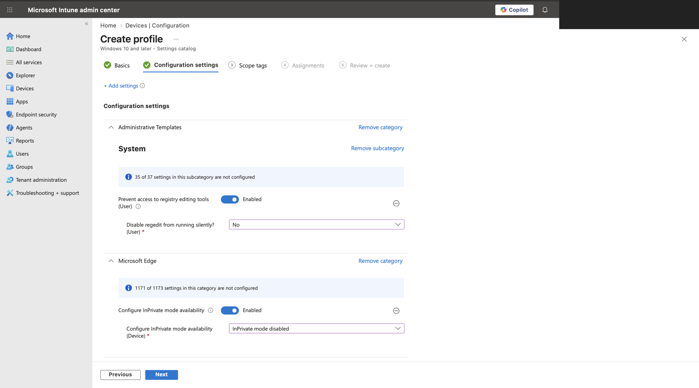
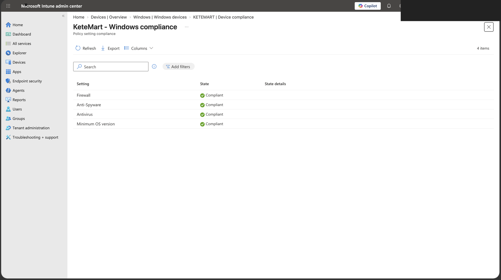
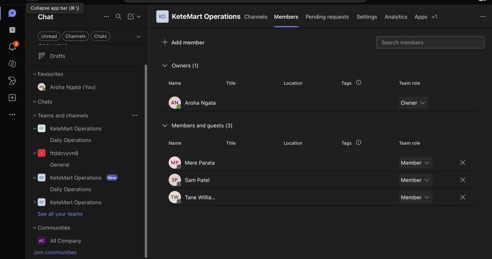
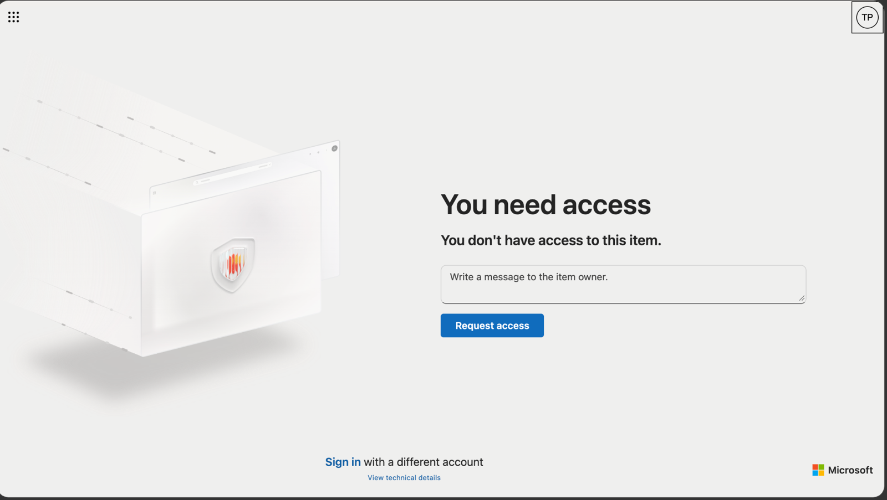
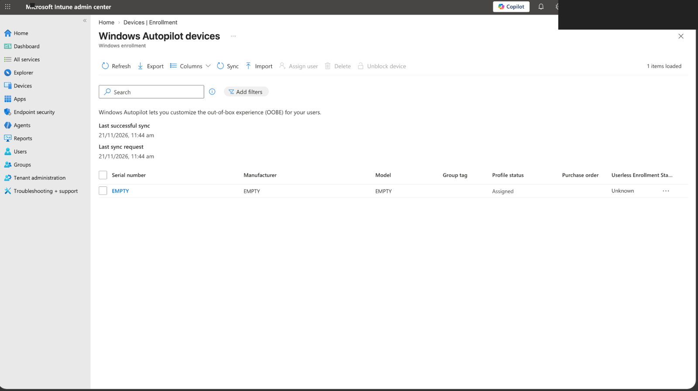

# KeteMart Microsoft 365 Modern Workplace

A practical Microsoft 365 pilot for a fictional retail business, covering cloud identity, secure sign-in, Windows endpoint management, staff collaboration and device provisioning.

**Author:** Tirth Patel  
**Platforms:** Microsoft Entra ID, Microsoft Intune, Microsoft 365, Windows 11, OneDrive, Teams, SharePoint and Windows Autopilot.

## Project overview

KeteMart needs secure staff access, consistently configured workstations, shared operational documents and a repeatable process for replacement devices. This project documents how those needs were addressed in a Microsoft 365 developer lab using fictitious staff accounts and a Windows 11 virtual machine.

The repository contains an implementation portfolio with 49 screenshots and selected image previews. It records configuration, observed device behaviour, access tests and troubleshooting limitations. It is a documentation portfolio; application source code and reusable deployment scripts were not supplied.

## Read the portfolio

[Download the implementation portfolio](docs/KeteMart_Microsoft_365_Portfolio.docx)

Download the Word file and open it in a DOCX-compatible editor. Student identifiers, college/course labels, identifying account details and the historical MFA number-matching code have been removed or redacted for publication. The tenant screenshots show a lab environment, not a production customer deployment.

## Business requirements

| Requirement | Approach | Intended benefit |
| --- | --- | --- |
| Protect staff sign-in | Entra ID, MFA and targeted Conditional Access | Reduce access based on stolen passwords |
| Standardise workstations | Entra join, Intune enrolment, settings and application assignments | Centralise setup and remote support |
| Support shared work | OneDrive, Teams and SharePoint | Improve document access and reduce duplicate working copies |
| Restrict confidential files | A private manager channel and access tests | Limit sensitive documents to authorised staff |
| Prepare replacement devices | User-driven Autopilot profile and device assignment | Establish the configuration for future provisioning tests |

## Implementation and evidence

### Identity and administration

- Documented four representative staff/support roles, group membership and Microsoft 365 E5 Developer licensing.
- Recorded Global Administrator, Helpdesk Administrator and Intune Administrator assignments.
- Explained separation of routine staff work from elevated administration where practical.

### MFA and Conditional Access

- Recorded an actual Authenticator number-matching challenge and a subsequent signed-in application screen.
- Documented targeted MFA policy configuration and sign-in log contexts, including successful and not-applied evaluations.
- Compared MFA with stricter compliant-device requirements and explained the effect on enrolment and support.

A not-applied Conditional Access result must be interpreted against the account, application and sign-in context; it is not automatically evidence that every intended access condition was enforced.

### Windows enrolment and configuration

- Recorded the KETEMART Windows 11 VM in Entra ID and Intune.
- Assigned workstation settings to devices and recorded a corrected assignment without exclusions.
- Verified that Registry editing was blocked on the managed workstation.
- Verified the Edge policy value and the disabled InPrivate menu option.
- Recorded Company Portal as installed in Intune and opened it on the managed device.



### Compliance, endpoint protection and updates

- Documented compliance settings, assignment, overall status and individual check results.
- Configured a Defender Antivirus control and recorded the PowerShell `PUAProtection` result as `2`.
- Documented update-ring settings, assignment and a reported device result.
- Recorded Windows sync information and an Intune sync-status screen.

The sync-status screenshot contains both completed and failed policy results. It is retained as troubleshooting evidence and does not establish that every policy succeeded. The recorded Defender value is an observed result; the portfolio does not demonstrate a malware-blocking test.



### OneDrive, Teams and SharePoint

- Recorded the organisational OneDrive account, local file availability and the Known Folder Move selection screen.
- Tested a file appearing on OneDrive web and a renamed/updated file after synchronisation.
- Created an Operations team, channels and a SharePoint-backed document library.
- Recorded contributions from two fictitious users in a shared document.
- Used a private Manager Only channel for restricted documents.
- Tested an authorised manager opening a document and an ordinary employee receiving a denied-access screen.

The Known Folder Move screenshot shows backup selections; it is not a completed backup or restore test.





### Windows Autopilot

- Configured a user-driven Microsoft Entra joined deployment profile with a standard user account.
- Assigned the profile to the KeteMart Autopilot Devices group.
- Imported a VM device record and recorded profile status **Assigned**.
- Documented an Enrollment Status Page configuration.

**Provisioning limitation:** VirtualBox exposed incomplete hardware identity fields, and the Windows reset stalled and was aborted. A completed out-of-box experience, successful Autopilot enrolment and post-Autopilot policy/application delivery were not verified. The earlier manually enrolled device evidence is not presented as proof of successful Autopilot provisioning.



## Repository contents

```text
KeteMart-Microsoft-365-Modern-Workplace/
├── README.md
├── docs/
│   └── KeteMart_Microsoft_365_Portfolio.docx
└── assets/
    ├── figure-15.png
    ├── figure-24.png
    ├── figure-28.png
    ├── figure-39.png
    ├── figure-44.png
    └── figure-48.png
```

## Validation and remaining work

This repository documents historical lab evidence; no live tenant was accessed during publication preparation. To extend the pilot:

1. Investigate the failed policy result shown in the sync-status screen and verify remediation after device check-in.
2. Confirm that Conditional Access evaluations match the intended users, applications and access contexts.
3. Verify Known Folder Move completion and perform a controlled recovery test.
4. Retest Autopilot with a supported device identity and capture the complete reset and out-of-box flow.
5. Confirm Entra join, Intune enrolment, settings and required applications after Autopilot provisioning.

Recreating the lab requires appropriate tenant access, licences, administrator permissions, a supported Windows device and internet connectivity. No credentials or tenant access are provided by this repository.

## Technical skills represented

Microsoft 365 administration, Entra ID, MFA, Conditional Access, role-based administration, Intune enrolment, device configuration, compliance policies, Defender policy verification, Windows update rings, Company Portal deployment, OneDrive synchronisation, Teams and SharePoint permissions, Windows Autopilot configuration, troubleshooting and technical evidence reporting.
